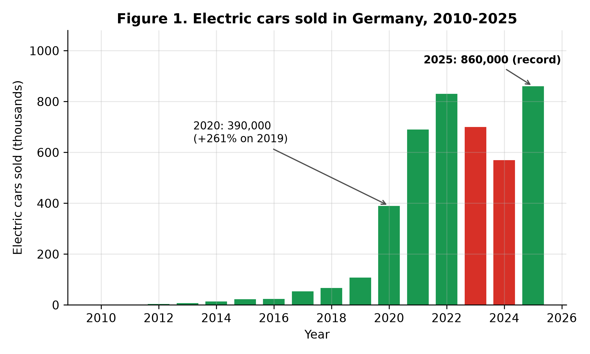
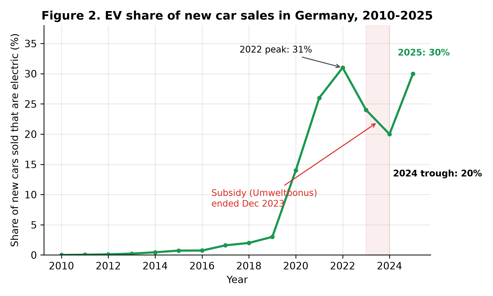
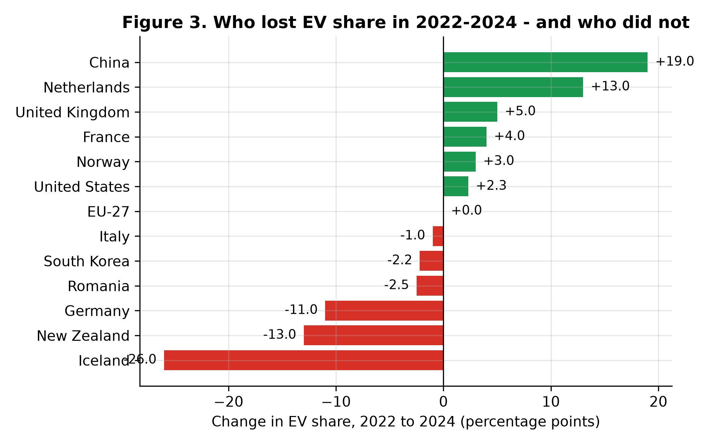
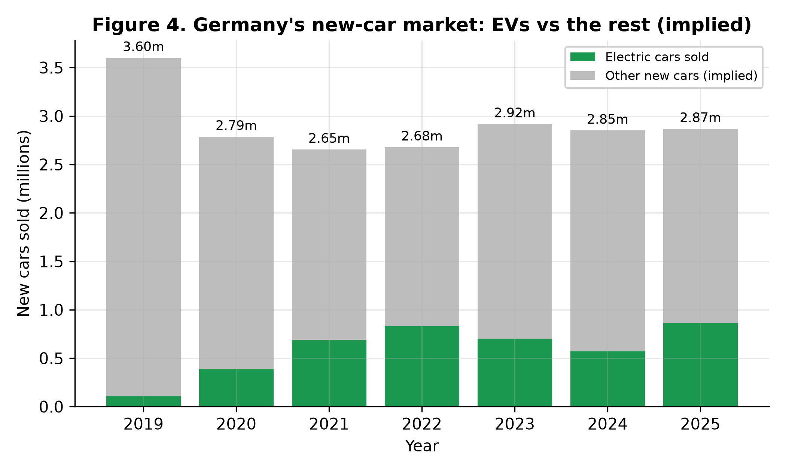
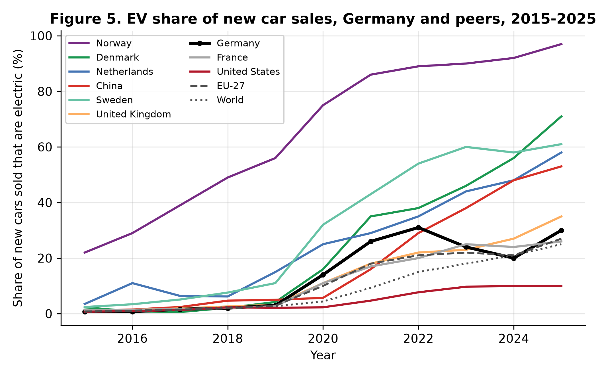
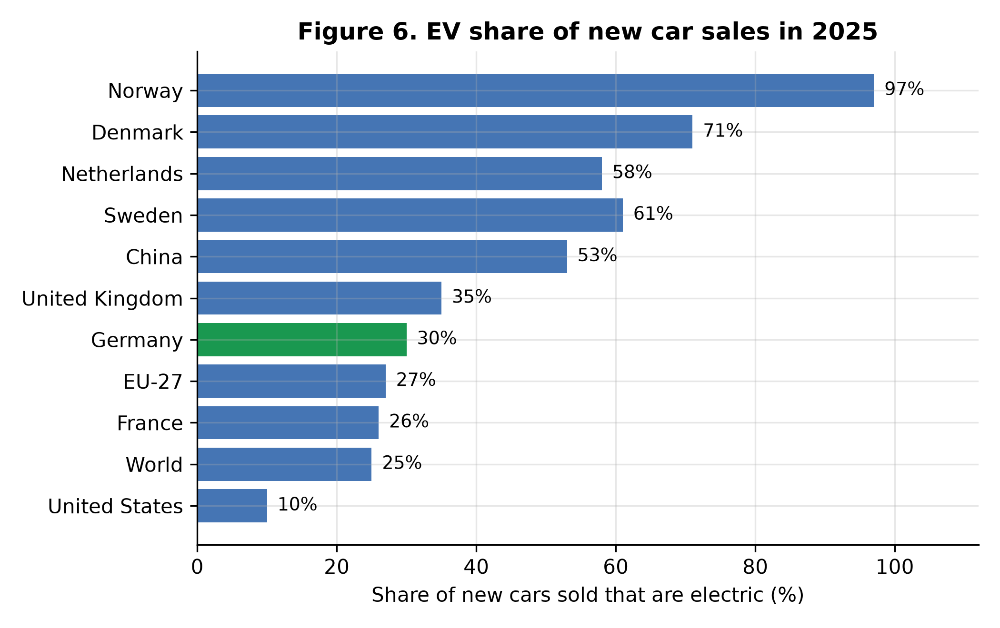
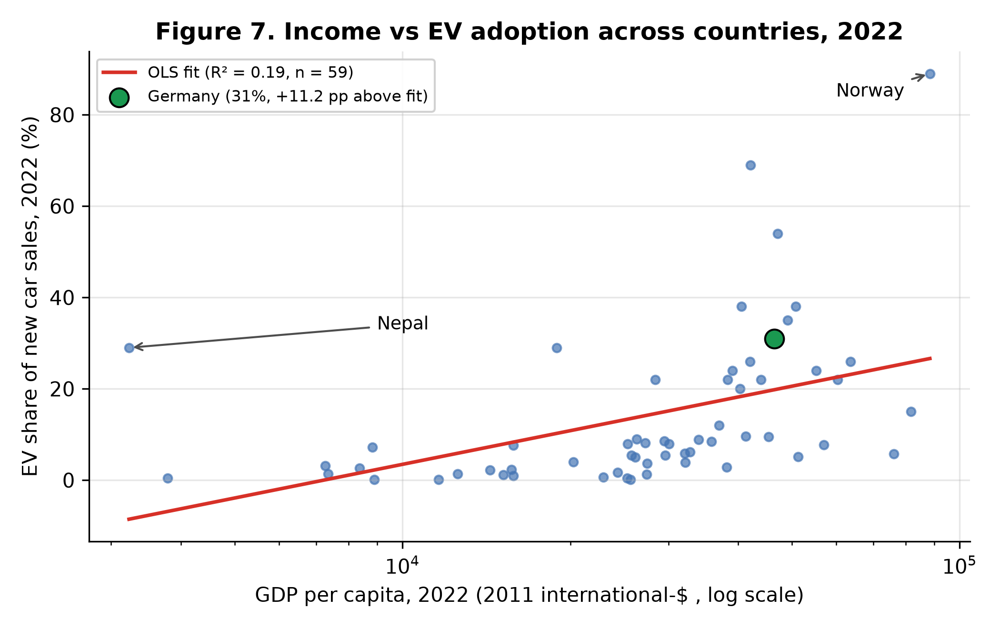
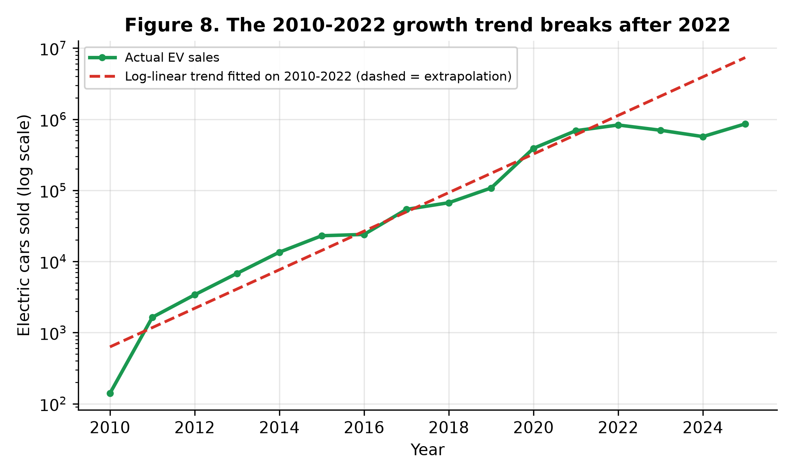

# From 140 to 860,000: Electric Vehicle Adoption in Germany, 2010–2025 — Growth, the Subsidy Shock, and the European Comparison

**Rashed Rana**
Master's student, Artificial Intelligence for Industrial Applications,
OTH Amberg-Weiden, Germany

*Manuscript prepared for journal submission. All results are computed from
the published datasets cited below; the complete analysis code (Python and
SQL) is openly available (see Data Availability).*

---

## Abstract

Germany sold 140 electric cars in 2010 and 860,000 in 2025. This study
analyses that fifteen-year transition using the International Energy
Agency's electric-car series, republished by Our World in Data, for
2010–2025, with descriptive statistics, growth accounting, ordinary
least-squares regression and a structured SQL analysis, and benchmarks
Germany against European peers, China, the United States and the world.
The electric share of new car sales rose from 0.005% in 2010 to 30.0% in
2025, with sales growing at a compound rate of 106.3% per year between
2010 and 2022 and doubling roughly every 1.1 years. The take-off came in
2020, when sales jumped 261.1% in a single year (108,000 to 390,000) as
the purchase subsidy was raised and the EU fleet CO2 target took effect.
The defining event of the series is the subsidy shock: after the
Umweltbonus purchase subsidy was cut in January 2023 and terminated in
December 2023, German electric sales fell 31.3% between 2022 and 2024
(830,000 to 570,000) and the market share fell 11 percentage points
(31% to 20%), while the EU-27 share was flat and France, the
Netherlands, the United Kingdom and China all gained. The total new-car
market was roughly unchanged over the same period, so the collapse was a
share collapse, not a market collapse. In 2025 the market rebounded to
record sales of 860,000 and a 30% share — before any new purchase
subsidy existed. Across 59 countries in 2022, income is a significant
but weak predictor of adoption (OLS slope 10.63 percentage points per
log unit of GDP per capita, R² = 0.19, p = 0.0006); Germany sat 11.2
points above its income-predicted share, consistent with policy, not
income, doing the heavy lifting. Cumulative electric sales of 4.34
million by 2025 leave Germany far from its target of 15 million
electric cars on the road by 2030, which would require about 2.13
million sales per year — 2.48 times the 2025 pace.

## 1. Introduction

Road transport is the hardest part of Germany's energy transition to
move. Electricity generation has been transformed in a generation, but
cars turn over slowly, cost more to replace than a power station costs
to re-fuel, and their buyers decide one household at a time. Electric
cars — battery-electric and plug-in hybrid cars together, as counted in
this paper — are the main technology on offer for decarbonising that
sector, and Germany is the test case that matters most in Europe: it
is the continent's largest car market, its largest car producer, and
the country whose industrial future is most tied to the electric
transition [1]. In 2025 Germany was the world's third-largest electric
car market by volume, behind only China and the United States, yet only
19th of 59 countries by market share. That tension — industrial scale
without adoption leadership — is the subject of this paper.

The German series is unusually instructive because it contains a sharp,
dated policy change inside a long growth trend. For twelve years
electric sales grew almost without interruption, doubling roughly every
1.1 years. Then, within thirteen months, the federal purchase subsidy
(the Umweltbonus) was cut, restricted to private buyers, and abolished
altogether, and sales fell for two consecutive years — the only
two-year fall in the series — before rebounding to a record in 2025.
Few countries offer so clean a before-and-after, and few offer it in a
market large enough to matter for European climate targets.

This paper asks four questions. First, how fast did electric adoption
actually grow in Germany, and when did it take off? Second, what
happened when the subsidy was removed, and was the fall specific to
Germany? Third, where does Germany stand internationally in 2025?
Fourth, how much of the cross-country pattern does income explain, and
how much is left for policy? The answers come entirely from published
data: the International Energy Agency's electric-car series as
republished by Our World in Data, covering 2010–2025, with GDP per
capita from the World Bank series carried in the Our World in Data CO2
dataset. Every number in the paper is produced by the accompanying
Python and SQL code; nothing is typed by hand.

## 2. Literature review

The literature on electric vehicle adoption converges on four groups of
drivers: purchase price and incentives, charging infrastructure,
vehicle characteristics (above all range), and consumer attitudes and
socio-economic position. Egbue and Long [4] surveyed technology
enthusiasts and found that battery range was the largest concern,
followed by cost, while sustainability weighed less than cost and
performance; they also found that consumers resist technologies they
consider unproven, so policy that ignores those concerns fails.
Coffman, Bernstein and Wee [5], reviewing the field a decade into the
modern electric car, concluded that the evidence on incentives was
mixed — particularly on timing and magnitude — and that public charging
infrastructure was associated with uptake, although the direction of
causality was unclear.

The cross-country econometric literature is more decisive about
incentives. Sierzchula et al. [3] regressed 2012 market shares for 30
countries on incentives and socio-economic factors and found financial
incentives, charging infrastructure and local production presence to be
significant, with charging infrastructure the strongest correlate.
Münzel et al. [6] reviewed the econometric literature and estimated a
panel model for 32 European countries (2010–2017), finding that €1,000
of additional incentive raised the plug-in share by about 5–7% in
relative terms, controlling for income and fuel prices. Schub, Plötz
and Sprei [11] extended this to company cars — which dominate German
registrations — and found that a €1,000-per-year recurring company-car
incentive raised sales shares by 17–40% for battery-electric cars.
Hardman et al. [7] reviewed charging behaviour and found home charging
the most important location, followed by work and then public charging;
Gnann et al. [8] modelled fast-charging needs and found that about one
fast-charging point per 1,000 battery-electric cars could suffice at
high power levels; Funke et al. [9] reviewed how much charging
infrastructure electric vehicles need and how it compares
internationally.

Norway is the reference case for what sustained, generous policy can
do. Figenbaum [10] documents how three decades of tax exemptions —
registration tax from 1990, VAT exemption from 2001, free tolls and
parking — built the world's most electrified new-car market, reaching
97% electric share in 2025 in the data used here. Germany's
Umweltbonus, introduced on 2 July 2016 at €4,000 for battery-electric
cars and €3,000 for plug-in hybrids, raised to up to €9,000 in 2020,
then cut in January 2023 (with plug-in hybrid support ended entirely),
restricted to private buyers in September 2023, and terminated on
18 December 2023 [13], offers the opposite experiment: a large subsidy
removed quickly. The International Energy Agency's Global EV Outlook
2025 [1] records the global context — more than 17 million electric
cars sold worldwide in 2024, over 20% of new car sales, with European
sales stagnating as subsidies were phased out — and notes that the EU
CO2 targets for cars were unchanged between 2023 and 2024, removing one
source of pressure exactly when German support ended. The EU fleet
target itself, 95 g CO2/km from 2020 with a further 15% tightening
from 2025, is set by Regulation (EU) 2019/631 [12].

This paper contributes a complete, reproducible account of the German
case through 2025 — including the rebound year — using a single
consistent data source, a cross-country income regression for the same
year as the literature's benchmarks, and an explicit test of whether
the 2023–2024 fall was a German phenomenon or a European one.

## 3. Data and methods

**Data.** Electric car sales (battery-electric plus plug-in hybrid) and
the electric share of new car sales come from the International Energy
Agency's Global EV Outlook series, as republished by Our World in Data
in its "electric-car-sales" and "electric-car-sales-share" datasets [2].
Coverage is annual, 2010–2025, for 64 countries plus the European
Union (27) and world aggregates. GDP per capita (2011
international-$) comes from the World Bank series carried in the Our
World in Data CO2 dataset, which is published through 2022; the
cross-country regression therefore uses 2022, the latest year with both
variables. Throughout the paper "electric car" (EV) means
battery-electric plus plug-in hybrid; where cited work reports
battery-electric cars only, this is stated.

**Methods.** All headline figures are computed in Python
(pandas/statsmodels) and saved to `outputs/results.json`; nine
documented SQL queries (SQLite) reproduce the key tables in
`outputs/sql_results.md`. Growth is measured with compound annual
growth rates and a log-linear trend fitted by ordinary least squares
(OLS) on 2010–2022. The subsidy shock is measured as the change in
sales and share between 2022 and 2024 for Germany and for peers, and
cross-checked against the list of countries whose share fell
(SQL Q8). The implied total new-car market is derived as EV sales
divided by EV share; because the source rounds shares (to whole
percentages in recent years), these totals are approximate. The
cross-country model is OLS of EV share on the natural logarithm of GDP
per capita for 2022 (n = 59), with a sensitivity check excluding
Nepal, an outlier discussed below. The 2030 target arithmetic divides
the remaining gap to 15 million cars by the five years 2026–2030.
Causality is not claimed from the timing of the subsidy removal alone:
the paper treats it as a before-and-after comparison against peer
countries, not as an identified causal estimate.

## 4. Results

### 4.1 Fifteen years of growth

Germany sold 140 electric cars in 2010 and 860,000 in 2025 — a
6,142.9-fold increase (Figure 1). The electric share of new car sales
rose over the same period from 0.005% to 30.0%. Growth was fastest
early: the compound annual growth rate of sales was 106.3% per year
between 2010 and 2022, and 78.9% per year over the full 2010–2025
period. A log-linear trend fitted to 2010–2022 has a slope of 0.624 per
year (R² = 0.948), equivalent to sales doubling every 1.11 years; the
share trend over the same years was +2.11 percentage points per year,
though with a weaker fit (R² = 0.595) because the growth came in
steps, not smoothly.

*Figure 1. Electric cars sold in Germany, 2010–2025. Sales fell in
2023 and 2024 — the only two-year fall in the series — and then set a
record in 2025.*

Cumulative electric sales reached 2.21 million by the end of 2022,
3.48 million by the end of 2024 and 4.34 million by the end of 2025.
That cumulative figure is an upper-bound proxy for the electric fleet
on the road, since it ignores retirements; the true fleet is somewhat
smaller.

### 4.2 The 2020 take-off

For most of the 2010s electric cars were a rounding error in Germany:
23,000 sold in 2015 (0.73% share), 108,000 in 2019 (3.0%). The
take-off came in 2020, when sales jumped 261.1% in one year — from
108,000 to 390,000 — and the share leapt from 3% to 14%. Sales then
rose to 690,000 in 2021 (26%) and 830,000 in 2022 (31%). Two things
coincided in 2020: the purchase subsidy was raised to up to €9,000
(the "Innovation premium"), and the EU fleet target of 95 g CO2/km
took effect [12, 13], forcing manufacturers to sell electric cars or
pay fines. The data cannot separate the two effects, and this paper
does not try; the point is that 2020, not any earlier year, is when
electric cars stopped being marginal in Germany. The EU-27 share
followed the same pattern (2.9% in 2019, 10.0% in 2020), confirming
that the take-off was European, driven by the fleet target, with the
German subsidy adding national momentum.

### 4.3 The subsidy shock of 2023–2024

The defining event of the German series is the removal of the
Umweltbonus. The subsidy was cut in January 2023 and plug-in hybrid
support ended; commercial buyers lost eligibility in September 2023;
and the scheme was terminated entirely on 18 December 2023 [13].
German electric sales fell from 830,000 in 2022 to 700,000 in 2023
(−15.7%) and 570,000 in 2024 (−18.6%) — a total fall of 31.3% — and
the market share fell from 31% to 24% to 20%, a loss of 11 percentage
points (Figure 2).

*Figure 2. EV share of new car sales in Germany, 2010–2025. The
subsidy was cut in January 2023 and terminated in December 2023; the
share fell 11 points in two years and recovered in 2025.*

Three checks show this was a German policy event, not a market
collapse. First, the total new-car market did not collapse: the
implied total market — EV sales divided by EV share — was 2.68 million
in 2022, 2.92 million in 2023 and 2.85 million in 2024, up 6.4% over
the two years (Figure 4). Buyers kept buying cars; they stopped buying
electric ones. Second, peers moved the other way (Figure 3): between
2022 and 2024 the EU-27 share was flat (21% to 21%), France gained 4.0
points (20% to 24%), the Netherlands 13.0 points (35% to 48%), the
United Kingdom 5.0 points (22% to 27%), China 19.0 points (29% to
48%) and the United States 2.3 points (7.7% to 10.0%). Third, among
all countries in the data, only two lost more share than Germany
between 2022 and 2024 — Iceland (−26 points) and New Zealand (−13
points) — and New Zealand had likewise just removed its purchase
subsidy, the Clean Car Discount, on 31 December 2023 [15]. Germany
was the third-largest loser in the world, and the largest among major
markets.

*Figure 3. Change in EV share of new car sales, 2022 to 2024. Germany
was the third-largest loser worldwide; the countries that lost most
had all recently removed purchase incentives.*

*Figure 4. Germany's new-car market (implied totals: EV sales divided
by EV share), 2019–2025. The total market was roughly flat while the
electric share collapsed — the fall was a share collapse, not a market
collapse.*

The rebound came in 2025, before any new purchase subsidy existed:
sales rose 50.9% to 860,000 — a new record — and the share recovered
10 points to 30.0%, just one point below the 2022 peak. A new
income-graduated purchase grant was only introduced on 1 January 2026,
so it cannot explain the 2025 recovery. The plausible drivers are the
15% tightening of the EU fleet CO2 target from 2025 [12], cheaper
models reaching the market, and the depreciation allowance for company
cars introduced in 2024 — but the data used here cannot separate them,
and the paper records the rebound as a fact to be explained, not as
proof of any single cause.

### 4.4 Germany in the world, 2025

By 2025 the world sold 21.2 million electric cars, a quarter of all new
cars (25.0% share), and Germany's 860,000 sales made it the third-largest
market in volume — 4.1% of world electric sales — behind China (13.3
million) and the United States (1.53 million). But by share, Germany
ranked only 19th of 59 countries with data (Figure 6). Norway sold
97% electric, Denmark 71%, Sweden 61%, the Netherlands 58% and China
53%; the United Kingdom reached 35% and France 26%, while the EU-27
stood at 27% and the world at 25%. Germany, at 30%, sat just above the
EU average and five points above the world average — respectable, but
far from the leaders.

*Figure 5. EV share of new car sales, Germany and peers, 2015–2025.
Germany's line is the only one among the leaders that falls in
2023–2024.*

*Figure 6. EV share of new car sales in 2025. Germany ranks 19th of 59
countries by share, but 3rd by volume.*

The trajectories (Figure 5) show that Germany's dip is the exception,
not the rule: every other country in the comparison rose or held
steady through 2023–2024. They also show how late Germany's take-off
was relative to the north: Norway passed 20% in 2015, when Germany was
at 0.73%; the Netherlands passed 25% in 2020, when Germany was at 14%.
Germany caught up fast in 2020–2022 and then gave back a third of its
gain in two years.

### 4.5 Income and adoption: the cross-country regression

Is Germany's adoption level what its income would predict? For 2022 —
the latest year with GDP per capita for the same countries — an OLS
regression of EV share on the logarithm of GDP per capita across 59
countries gives a slope of 10.63 percentage points per log unit
(p = 0.0006), an intercept of −94.44, and R² = 0.189 (Figure 7).
Income matters — the correlation is 0.434 — but it explains less than
a fifth of the variation in adoption. At Germany's GDP per capita of
$46,495, the model predicts a 19.8% share; Germany's actual share was
31.0%, a residual of +11.2 points. In other words, Germany adopted
well ahead of what its income alone would suggest — consistent with
the literature's finding that policy and infrastructure, not income,
separate leaders from laggards [3, 6].

*Figure 7. EV share of new car sales against GDP per capita, 2022
(n = 59). Income is significant but explains only 19% of the
variation; Germany sits 11.2 points above its income-predicted share.*

Two outliers deserve comment. Norway (89% share in 2022) sits far
above the line, as three decades of tax exemptions would predict [10].
Nepal (29% share at $3,229 GDP per capita) sits far above it for the
opposite reason: a near-total exemption of electric cars from import
duty made them the cheap option. Excluding Nepal, the slope rises to
13.95 and R² to 0.278 (n = 58); the conclusion is unchanged. The
regression is descriptive, not causal: income correlates with
charging infrastructure, education, urbanisation and policy capacity,
all omitted here.

### 4.6 The broken trend and the 2030 target

The log-linear trend fitted on 2010–2022 (Figure 8) describes the
early phase well (R² = 0.948), but it cannot be extrapolated: extended
to 2024 it predicts 3.94 million sales — more than the entire German
new-car market of 2.85 million that year. Exponential growth at the
early-phase rate was already arithmetically impossible by 2023, even
before the subsidy ended; saturation, not only policy, ended the
doubling era. The honest reading of Figure 8 is that the growth regime
changed, and the subsidy removal determined how hard the landing was.

*Figure 8. Electric car sales on a log scale, with the trend fitted on
2010–2022 extrapolated. The extrapolation exceeds the whole German car
market by 2024: the early growth rate could not have continued.*

That arithmetic matters for the target. Germany aims to have 15
million electric cars on the road by 2030 [14]. Cumulative sales by
the end of 2025 were 4.34 million — an upper bound on the fleet, since
it ignores retirements — leaving a gap of 10.66 million cars to be
added in the five years 2026–2030, or about 2.13 million sales per
year. That is 2.48 times the record 2025 pace of 860,000. Even if
sales grew 20% every year from 2025, they would reach only about
2.14 million in 2030 itself, and the five-year total would still fall
short. On the evidence of this series, the 15-million target is not
reachable on the current trajectory; it would require a second
take-off of the size of 2020–2022, sustained for five years.

| Year | EV sales | EV share (%) | Implied total market |
| ---: | ---: | ---: | ---: |
| 2010 | 140 | 0.005 | — |
| 2015 | 23,000 | 0.73 | — |
| 2019 | 108,000 | 3.0 | 3,600,000 |
| 2020 | 390,000 | 14.0 | 2,785,714 |
| 2021 | 690,000 | 26.0 | 2,653,846 |
| 2022 | 830,000 | 31.0 | 2,677,419 |
| 2023 | 700,000 | 24.0 | 2,916,667 |
| 2024 | 570,000 | 20.0 | 2,850,000 |
| 2025 | 860,000 | 30.0 | 2,866,667 |

*Table 1. Germany: electric car sales, electric share of new car
sales, and the implied total new-car market (EV sales divided by EV
share; totals are approximate because the source rounds shares).*

| Country | EV sales 2025 | EV share 2025 (%) | EV share 2015 (%) |
| --- | ---: | ---: | ---: |
| Norway | 172,800 | 97.0 | 22.0 |
| Denmark | 134,700 | 71.0 | 2.3 |
| Sweden | 173,000 | 61.0 | 2.4 |
| Netherlands | 228,000 | 58.0 | 3.5 |
| China | 13,300,000 | 53.0 | 1.1 |
| United Kingdom | 700,000 | 35.0 | 1.1 |
| Germany | 860,000 | 30.0 | 0.73 |
| EU-27 | 2,900,000 | 27.0 | 0.82 |
| France | 450,000 | 26.0 | 1.2 |
| World | 21,200,000 | 25.0 | 0.68 |
| United States | 1,530,000 | 10.0 | 0.7 |

*Table 2. Electric car sales and shares in 2025 for Germany and
comparators, with 2015 shares for reference.*

| Model | n | Slope (pp per log GDP pc) | R² | p (slope) |
| --- | ---: | ---: | ---: | ---: |
| EV share ~ log GDP per capita, 2022 | 59 | 10.63 | 0.189 | 0.0006 |
| Excluding Nepal | 58 | 13.95 | 0.278 | < 0.0001 |

*Table 3. Cross-country OLS regression of EV share on log GDP per
capita, 2022. Germany: actual share 31.0%, predicted 19.8%, residual
+11.2 points.*

## 5. Discussion

Three findings stand out. First, the German electric transition is
real but fragile: fifteen years of growth produced a 30% market share,
yet a single policy decision removed a third of it within two years.
The literature predicts exactly this sensitivity — Münzel et al. [6]
estimate 5–7% relative share gains per €1,000 of incentive, and the
German bonus was worth up to €9,000 — but the German case shows the
effect in reverse, at national scale, and larger than the
cross-sectional estimates imply, because the removal coincided with
the end of plug-in hybrid support and with flat EU fleet targets [1].
Second, the fall was German, not European: no peer country fell, and
the only countries that fell further had also removed incentives. That
comparison is the paper's strongest evidence that the subsidy, rather
than a general market downturn, caused the fall — reinforced by the
flat total market. Third, income does not explain adoption: Germany
out-adopted its income by 11 points in 2022, Nepal did so at one
fourteenth of Germany's income, and the richest countries are not the
leaders. Policy design — the size, duration and predictability of
incentives, plus charging infrastructure [3, 7, 8] — is doing the
work that income cannot.

The 2025 rebound complicates any simple "subsidy on, sales up;
subsidy off, sales down" story. Sales recovered to a record without a
purchase subsidy, in the year the EU fleet target tightened by 15%
[12]. One plausible reading is that the market has matured: cheaper
models, more choice and a larger charging network now carry growth
that only subsidies could carry in 2020. Another is that the rebound
is manufacturer-driven compliance with the 2025 fleet target rather
than consumer demand. The data used here cannot distinguish these
readings; distinguishing them needs model-level price and registration
data, and is the clear next step.

For Germany's industrial policy the implication is uncomfortable.
The country is Europe's largest car producer and its third-largest
electric market, yet it ranks 19th on adoption and its 15-million-car
target requires two and a half times the record sales pace, every year
to 2030. The new income-graduated purchase grant introduced on
1 January 2026 may help, but the 2023 experience shows that abrupt
removal destroys more than gradual introduction creates. Predictable,
long-lived incentives — the Norwegian lesson [10] — matter more than
generous, short-lived ones.

## 6. Limitations

This study has five main limitations. First, the analysis is annual
and national: it cannot show within-year dynamics (the December 2022
and January 2024 jumps reported in monthly registration data) or
regional differences, and it cannot identify the causal effect of the
subsidy removal — the peer comparison is suggestive, not an
identification strategy. Second, the IEA/OWID series counts
battery-electric and plug-in hybrid cars together; the two
technologies responded differently to the subsidy changes (plug-in
hybrid support ended first), and this paper cannot separate them.
Third, the implied total market is derived from rounded shares and is
approximate; the cumulative-sales fleet proxy ignores retirements and
overstates the fleet. Fourth, the cross-country regression is a
single-variable cross-section for 2022: it omits charging
infrastructure, fuel prices, model availability and policy variables
that the literature finds important [3, 5, 6], and GDP per capita is
published only through 2022, so the regression cannot use the latest
adoption year. Fifth, this paper has no charging-infrastructure data:
charging density is one of the strongest correlates of adoption in
the literature [3, 7], and its absence is the largest gap in the
analysis.

## 7. Conclusions

Electric cars went from 140 sales in 2010 to 860,000 in 2025 in
Germany, and from 0.005% to 30.0% of new car sales. The market took
off in 2020, collapsed by a third when the purchase subsidy was
removed in 2023–2024 while every peer country gained, and rebounded
to a record in 2025 without a subsidy. Income explains little of the
international pattern; policy explains much of it. The 15-million-car
target for 2030 requires about 2.13 million sales a year — 2.48 times
the record pace — and is not reachable on the current trajectory. The
German experience is a cautionary tale in both directions: subsidies
can build a market in three years, and removing them abruptly can
take a third of it away in two.

## Data availability

All data are public. Electric car sales and shares: International
Energy Agency, Global EV Outlook series, via Our World in Data
(ourworldindata.org/grapher/electric-car-sales and
/electric-car-sales-share, CC BY). GDP per capita: World Bank series
via the Our World in Data CO2 dataset (github.com/owid/co2-data).
Analysis code (Python), SQL queries, figures and results are in the
project repository: github.com/rashedrana/germany-electric-vehicle-adoption.

## References

1. International Energy Agency (2025). *Global EV Outlook 2025.*
   Paris: IEA.
2. Our World in Data (2026). "Electric car sales" and "Share of new
   cars that are electric" (data compiled from IEA, *Global EV
   Outlook*). ourworldindata.org/grapher/electric-car-sales.
   GDP per capita from the World Bank, via Our World in Data,
   *CO2 and Greenhouse Gas Emissions* dataset (github.com/owid/co2-data).
3. Sierzchula, W., Bakker, S., Maat, K. & van Wee, B. (2014). "The
   influence of financial incentives and other socio-economic factors
   on electric vehicle adoption." *Energy Policy* 68, 183–194.
   doi:10.1016/j.enpol.2014.01.043.
4. Egbue, O. & Long, S. (2012). "Barriers to widespread adoption of
   electric vehicles: An analysis of consumer attitudes and
   perceptions." *Energy Policy* 48, 717–729.
   doi:10.1016/j.enpol.2012.06.009.
5. Coffman, M., Bernstein, P. & Wee, S. (2017). "Electric vehicles
   revisited: a review of factors that affect adoption." *Transport
   Reviews* 37(1), 79–93. doi:10.1080/01441647.2016.1217282.
6. Münzel, C., Plötz, P., Sprei, F. & Gnann, T. (2019). "How large is
   the effect of financial incentives on electric vehicle sales? — A
   global review and European analysis." *Energy Economics* 84,
   104493. doi:10.1016/j.eneco.2019.104493.
7. Hardman, S., Jenn, A., Tal, G., Axsen, J., Beard, G., Daina, N.,
   Figenbaum, E., Jakobsson, N., Jochem, P., Kinnear, N., Plötz, P.,
   Pontes, J., Refa, N., Sprei, F., Turrentine, T. & Witkamp, B.
   (2018). "A review of consumer preferences of and interactions with
   electric vehicle charging infrastructure." *Transportation Research
   Part D* 62, 508–523. doi:10.1016/j.trd.2018.04.002.
8. Gnann, T., Funke, S., Jakobsson, N., Plötz, P., Sprei, F. &
   Bennehag, A. (2018). "Fast charging infrastructure for electric
   vehicles: Today's situation and future needs." *Transportation
   Research Part D* 62, 314–329. doi:10.1016/j.trd.2018.03.004.
9. Funke, S. Á., Sprei, F., Gnann, T. & Plötz, P. (2019). "How much
   charging infrastructure do electric vehicles need? A review of the
   evidence and international comparison." *Transportation Research
   Part D* 77, 224–242. doi:10.1016/j.trd.2019.10.024.
10. Figenbaum, E. (2017). "Perspectives on Norway's supercharged
    electric vehicle policy." *Environmental Innovation and Societal
    Transitions* 25, 14–34.
11. Schub, H., Plötz, P. & Sprei, F. (2025). "Electrifying company
    cars? The effects of incentives and tax benefits on electric
    vehicle sales in 31 European countries." *Energy Research and
    Social Science* 120, 103914. doi:10.1016/j.erss.2024.103914.
12. Regulation (EU) 2019/631 of the European Parliament and of the
    Council of 17 April 2019 setting CO2 emission performance
    standards for new passenger cars and for new light commercial
    vehicles. *Official Journal of the European Union* L 111,
    25 April 2019, p. 13.
13. Fuchs, B. (2026). "E-Mobility in Germany — A Comparison of
    Regional Development." In *Proceedings of the 9th International
    Conference on Sustainable Mobility*, Springer. (Umweltbonus
    timeline: introduced 2 July 2016; up to €9,000 in 2020; reduced
    January 2023; terminated 18 December 2023.)
14. European Alternative Fuels Observatory (2025). "Bridging the
    policy-action gap in Europe's electric vehicle market:
    Data-driven insights on market evolution, targets, and incentive
    phase-out strategies." *Proceedings of EVS38*, Gothenburg,
    June 2025. (Germany's target of 15 million electric vehicles by
    2030; BEV share 18.28% in 2023 to 13.47% in 2024.)
15. New Zealand Government (2024). "Government ends 'Ute Tax'."
    Beehive, 1 January 2024. (Clean Car Discount ended for vehicles
    registered after 31 December 2023.)

## Declaration

This manuscript was prepared with AI assistance for data analysis and
drafting, under the author's direction. All results were computed from
the published datasets with the openly available code listed above and
verified by the author, who takes full responsibility for the content.
This disclosure will be adapted to the author guidelines of the venue at
the time of submission.
